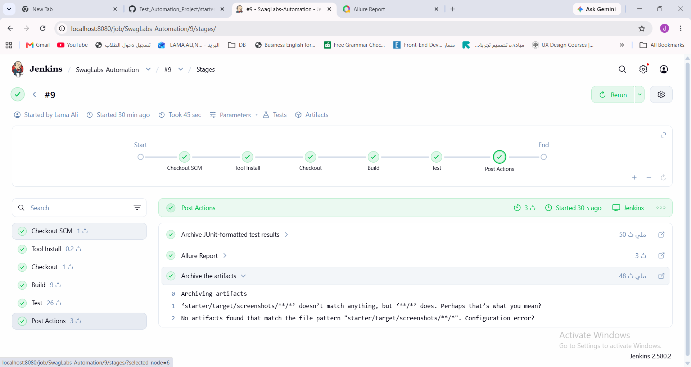
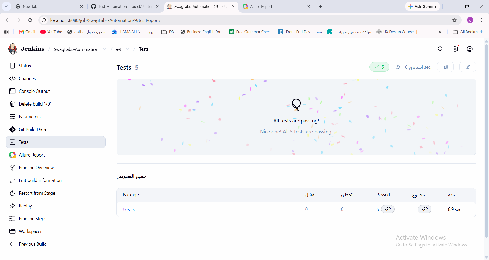
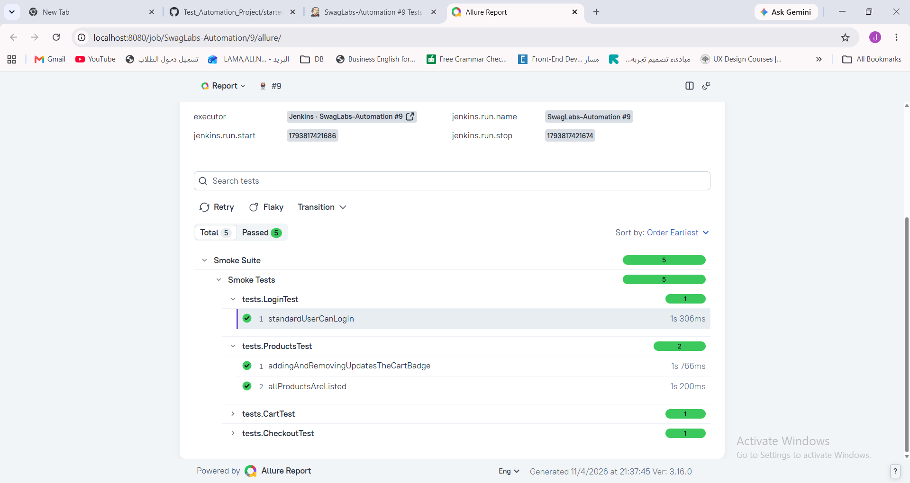
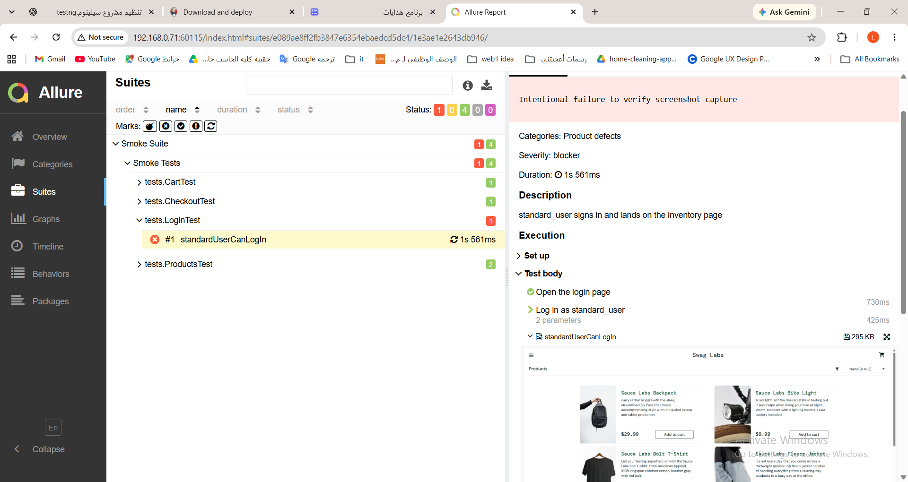

# Swag Labs — Test Automation Project

A Selenium WebDriver automation project for SauceDemo using Java, TestNG, Maven, Jenkins, and Allure.

## How to Run

**Requirements:** Java JDK, Maven, and Google Chrome.

Clone the repository:

```bash
git clone https://github.com/LamaAliNW/Test_Automation_Project.git
cd Test_Automation_Project/starter
```

Run the regression suite:

```bash
mvn clean test
```

Run the smoke suite:

```bash
mvn clean test -DsuiteXmlFile=testng-smoke.xml
```

Run the parallel suite:

```bash
mvn clean test -DsuiteXmlFile=testng-parallel.xml
```

View the Allure report:

```bash
mvn allure:serve
```

## Test Execution Evidence

### Jenkins — Successful Pipeline



### Jenkins — Smoke Tests



### Allure — Smoke Results



### Allure — Screenshot on Failure



## What I Would Automate Next

- Cross-browser testing with Firefox and Edge.
- Additional negative and boundary test cases.
- API testing for backend validation.
- Automatic Jenkins execution after GitHub updates.
